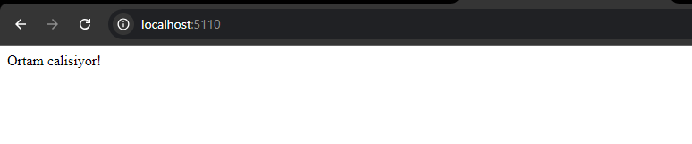
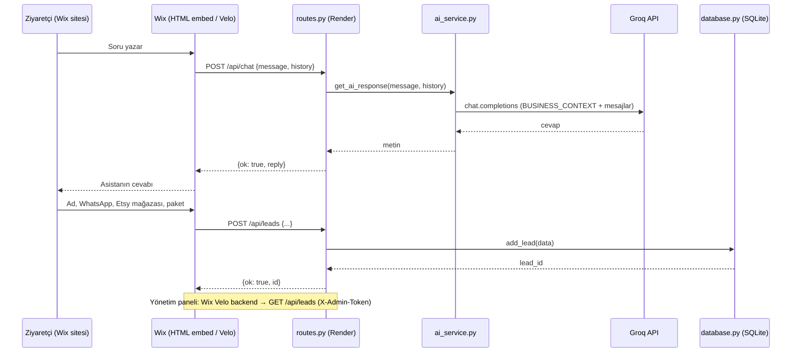

# SmartLead AI · AST Digital
## Ortam Kurulumu ve Mimari Tasarım Envanteri

**Hazırlayan:** Abdulsamed Tanrıverdi · **Marka:** AST Digital · **Tarih:** 7 Ekim 2026
**Eğitim:** Python ile Ürün Geliştirme · **Revize:** salih@humanports.com

---

## 1. Proje Özeti

SmartLead AI, AST Digital'in web sitesinde (Wix Studio) çalışan **akıllı satış asistanıdır**. AST Digital, Etsy'de satış yapan ya da yapmak isteyen üreticilere (tişört, kupa, tumbler gibi baskılı ve kişiye özel ürün satıcıları) dijital araçlar ve birebir danışmanlık sunar.

Asistanın üç görevi vardır:

1. Ziyaretçinin Etsy, listing, mockup ve paketlerle ilgili sorularını marka diliyle yanıtlamak.
2. Ziyaretçiyi ihtiyacına uygun pakete (Freemium / Premium) yönlendirmek.
3. Ziyaretçinin iletişim bilgisini (lead) toplayıp veritabanına kaydetmek ve işletme sahibinin bu kayıtları yönetim panelinde görmesini sağlamak.

Sistem iki arayüzden oluşur: ziyaretçinin sohbet ettiği **karşılama sayfası / sohbet penceresi** ve işletme sahibinin lead'leri gördüğü **yönetim paneli**.

---

## 2. Ortam Kurulumu

### 2.1 Hazırım Kontrol Listesi

| # | Madde | Durum |
|---|---|---|
| 1 | `py -3.11 --version` → Python 3.11.9 | ✅ |
| 2 | `git --version` → git 2.53.0 | ✅ |
| 3 | GitHub, Render, Wix hesapları açık | ✅ |
| 3b | Groq hesabı açık | ⬜ |
| 4 | Groq API anahtarı alındı ve `.env` içine kaydedildi | ⬜ |
| 5 | Klasör iskeleti hazır (Bölüm 3) | ✅ |
| 6 | `venv` aktif, `pip install -r requirements.txt` hatasız tamamlandı | ✅ |
| 7 | Duman testi tarayıcıda çalıştı | ✅ |

### 2.2 Kurulum Adımları (Windows · PowerShell)

```powershell
# Proje klasörü: C:\Users\samet\OneDrive\Desktop\SMARTLEAD.AI
mkdir app, app\templates, app\services
New-Item run.py, config.py, requirements.txt, .env, .gitignore, `
  app\__init__.py, app\database.py, app\routes.py, `
  app\templates\index.html, app\templates\dashboard.html, `
  app\services\__init__.py, app\services\ai_service.py

py -3.11 -m venv venv
venv\Scripts\activate
pip install -r requirements.txt
```

**Kurulu paketler:** flask 3.1.3 · flask-cors 6.0.5 · python-dotenv 1.2.4 · groq 1.7.0 · gunicorn 26.2.0

> Python 3.14 de bilgisayarda kurulu, ancak bazı paketlerin henüz tam uyumlu olmaması ihtimaline karşı sanal ortam bilinçli olarak **Python 3.11** ile kuruldu.

### 2.3 Duman Testi

`hello.py` (proje dosyası değil, yalnızca ortam testi) çalıştırıldı, tarayıcıda "Ortam calisiyor!" yanıtı alındı. 5000 portu bilgisayarda başka bir uygulama tarafından kullanıldığı için test 5110 portunda yapıldı.



---

## 3. Klasör Yapısı ve Dosya Sorumlulukları

```
SMARTLEAD.AI/
├── run.py                 ← Sunucuyu başlatan giriş noktası
├── config.py              ← Tüm ayarlar ve anahtarlar (.env okur)
├── requirements.txt       ← Bağımlılık listesi
├── .env                   ← Gizli anahtarlar (Git'e EKLENMEZ)
├── .gitignore             ← venv/, .env, __pycache__/, *.db
├── docs/
│   └── MIMARI.md          ← Bu belge
└── app/
    ├── __init__.py        ← Uygulama fabrikası: create_app()
    ├── database.py        ← SQLite işlemleri (SQL SADECE burada)
    ├── routes.py          ← HTTP rotaları (sadece yönlendirme)
    ├── templates/
    │   ├── index.html     ← Karşılama sayfası + sohbet penceresi
    │   └── dashboard.html ← Yönetim paneli
    └── services/
        ├── __init__.py
        └── ai_service.py  ← Yapay zekâ çağrıları (AI SADECE burada)
```

| Dosya | Tek sorumluluğu | Kesinlikle içermez |
|---|---|---|
| `config.py` | `.env`'den ayarları okuyup `Config` sınıfında toplamak | SQL, AI çağrısı, rota |
| `app/database.py` | Tabloyu oluşturmak, lead eklemek, lead listelemek | AI çağrısı, HTTP |
| `app/services/ai_service.py` | Groq'a istek atıp asistanın cevabını döndürmek | SQL, HTTP rotası |
| `app/routes.py` | İsteği karşılamak, doğrulamak, ilgili katmanı çağırmak, JSON döndürmek | SQL metni, Groq istemcisi |
| `app/__init__.py` | Flask uygulamasını kurmak, CORS'u ayarlamak, rotaları kaydetmek, veritabanını başlatmak | İş mantığı |
| `run.py` | `create_app()` ile uygulamayı oluşturup çalıştırmak | Her şey dışında |

**Mimari sözleşme:** `database.py` dışında hiçbir yerde SQL yoktur. `ai_service.py` dışında hiçbir yerde yapay zekâ API çağrısı yoktur. `routes.py` yalnızca bu iki katmanın fonksiyonlarını çağırır.

---

## 4. Veri Akışı



---

## 5. Veri Modeli

Tek tablo: **`leads`**

| Alan | Tür | Kural | Açıklama |
|---|---|---|---|
| `id` | INTEGER | PRIMARY KEY AUTOINCREMENT | Kayıt numarası |
| `name` | TEXT | NOT NULL | Ad soyad |
| `phone` | TEXT | | WhatsApp numarası |
| `email` | TEXT | | E-posta |
| `etsy_shop` | TEXT | | Etsy mağaza bağlantısı |
| `interest` | TEXT | `freemium` / `premium` / `bilinmiyor` | İlgilendiği paket |
| `message` | TEXT | | Ziyaretçinin notu veya sohbet özeti |
| `source` | TEXT | `chatbot` / `form` | Lead'in geldiği yer |
| `status` | TEXT | varsayılan `yeni` | `yeni` → `iletisime_gecildi` → `onaylandi` / `reddedildi` |
| `created_at` | TEXT | varsayılan `CURRENT_TIMESTAMP` | Kayıt zamanı |

**Kural:** `phone` veya `email` alanlarından en az biri dolu olmalıdır (iletişim kurulamayan lead kaydedilmez). Bu kontrol `routes.py`'de yapılır.

---

## 6. API Rotaları

| Metot | Yol | Girdi | Başarılı çıktı | Kim kullanır |
|---|---|---|---|---|
| GET | `/` | — | `index.html` | Ziyaretçi (test) |
| GET | `/dashboard` | — | `dashboard.html` | İşletme sahibi (test) |
| GET | `/health` | — | `{"ok": true}` | Render sağlık kontrolü |
| POST | `/api/chat` | `{"message": str, "history": [ {role, content} ]}` | `{"ok": true, "reply": str}` | Sohbet penceresi |
| POST | `/api/leads` | `{"name", "phone", "email", "etsy_shop", "interest", "message", "source"}` | `{"ok": true, "id": int}` (201) | Sohbet penceresi / form |
| GET | `/api/leads` | Başlık: `X-Admin-Token` | `{"ok": true, "leads": [...]}` | Yönetim paneli |

**Hata formatı (tüm rotalarda aynı):**

```json
{ "ok": false, "error": "Kullanıcıya gösterilebilecek kısa açıklama" }
```

| Durum | HTTP kodu |
|---|---|
| Eksik / hatalı girdi | 400 |
| Admin anahtarı yok veya yanlış | 401 |
| Veritabanı veya AI servisi hatası | 500 (ayrıntı loglanır, kullanıcıya gösterilmez) |

---

## 7. Modüllerin Fonksiyonları

Kod öğrenci tarafından yazılacaktır; aşağıdakiler her modülün **ne yapması gerektiğinin** tanımıdır.

**`config.py` → `class Config`**
`SECRET_KEY`, `DATABASE_URL` (varsayılan `smartlead.db`), `GROQ_API_KEY`, `AI_PROVIDER` (`groq`), `AI_MODEL`, `BUSINESS_CONTEXT`, `CORS_ORIGINS` (virgülle ayrılmış liste), `ADMIN_TOKEN`. Hepsi `os.getenv` ile `.env`'den okunur.

**`app/database.py`**
- `init_db()` → `leads` tablosunu yoksa oluşturur.
- `add_lead(data: dict) -> int` → `?` yer tutucularıyla INSERT yapar, yeni kaydın id'sini döndürür.
- `get_leads(limit: int = 100) -> list[dict]` → En yeni kayıtları sözlük listesi olarak döndürür.
- (Belgrad aşaması) `update_lead_status(lead_id, status)`.

**`app/services/ai_service.py`**
- `get_ai_response(message: str, history: list) -> str` → `BUSINESS_CONTEXT`'i sistem mesajı yapar, son birkaç mesajlık geçmişi ve yeni mesajı Groq'a gönderir, cevabın metnini döndürür. Hata olursa istisnayı yukarı fırlatır; `routes.py` bunu kibar bir JSON hataya çevirir.

**`app/routes.py`**
- Her rota: girdiyi doğrula → ilgili katmanı çağır → `jsonify` ile döndür. Tüm dış çağrılar `try-except` içinde.

**`app/__init__.py` → `create_app()`**
- `Config`'i yükler, `CORS(app, origins=Config.CORS_ORIGINS)` uygular, `init_db()` çağırır, rotaları Blueprint olarak kaydeder.

**`run.py`**
- `app = create_app()` · yerelde `app.run(port=5110, debug=True)` · Render'da `gunicorn run:app`.

---

## 8. Asistanın Kişiliği: `BUSINESS_CONTEXT`

Kodun konuya özel tek parçası budur. Diğer tüm katmanlar başka bir marka için aynen kullanılabilir.

```python
BUSINESS_CONTEXT = """Sen AST Digital'in asistanisin. AST Digital, Etsy'de satis yapan
ya da yapmak isteyen ureticilere (tisort, kupa, tumbler gibi baskili ve kisiye ozel
urun saticilari) dijital araclar ve birebir danismanlik sunar.

Paketler:
- Freemium (ucretsiz): gunde 5 listing + mockup, ticket ile destek, haftalik tanitim yayini.
- Premium (aylik 39 $, 7 gun ucretsiz deneme): gunde 20 listing + mockup,
  gunde 5 otomatik Pinterest pini, mesai saatlerinde WhatsApp'tan birebir danismanlik,
  haftalik soru-cevap yayini.
Uyelik basvuruyla acilir: kisa form doldurulur, Etsy magazasi incelenir, onaylanan
saticiya hesap acilir. Premium basvurularinda 20 dakikalik tanisma gorusmesi yapilir.

Kurallar:
- Turkce, samimi, net ve cesaret veren bir dille konus. Kisa yanit ver (en fazla 4-5 cumle).
- Kesin satis vaat etme; yolu kisaltmayi vaat et.
- Bilmedigin bir konuda uydurma; "Bunu ekibimiz netlestirsin" de ve iletisim bilgisi iste.
- Konusma ilerledikce ziyaretciye uygun paketi oner ve adini, WhatsApp numarasini
  ve Etsy magaza baglantisini birakmasini nazikce iste.
- Etsy, e-ticaret ve AST Digital disindaki konulara girme."""
```

---

## 9. Güvenlik

| Konu | Uygulama |
|---|---|
| SQL enjeksiyonu | Tüm sorgularda `?` yer tutucusu; kullanıcı verisi asla SQL metnine eklenmez. |
| Gizli anahtarlar | `GROQ_API_KEY`, `SECRET_KEY`, `ADMIN_TOKEN` yalnızca `.env`'de (yerel) ve Render "Environment" ayarlarında. `.env` `.gitignore`'da. |
| CORS | Yalnızca `https://astdigital.wixstudio.com` ve Wix editör/önizleme alan adlarına izin verilir; `*` kullanılmaz. |
| Lead listesi | `GET /api/leads` `X-Admin-Token` başlığı olmadan 401 döner. Wix tarafında bu anahtar tarayıcıya hiç inmez: Velo **backend** modülünden (`wix-fetch`) çağrılır, anahtar Wix **Secrets Manager**'da tutulur. |
| Girdi doğrulama | Boş mesaj, aşırı uzun mesaj (ör. 1000 karakter üstü) ve iletişim bilgisi olmayan lead 400 ile reddedilir. |
| KVKK | Sohbet penceresinde lead formu gönderilmeden önce KVKK aydınlatma metnine bağlantı ve onay kutusu gösterilir (site KVKK politikasıyla uyumlu). |

---

## 10. Hata Yönetimi

- Veritabanı ve Groq çağrıları `try-except` ile sarılır.
- Kullanıcıya teknik ayrıntı gösterilmez; yalnızca `{"ok": false, "error": "..."}` döner.
- Hatanın ayrıntısı sunucu loguna yazılır (Render "Logs" ekranından izlenir).
- Groq'a ulaşılamazsa asistan şu yedek cevabı verir: *"Şu an yanıt veremiyorum, bilgilerini bırakırsan ekibimiz WhatsApp'tan dönsün."* Böylece lead fırsatı kaçmaz.

---

## 11. Wix Bağlantısı

| Wix tarafı | Yöntem | Backend rotası |
|---|---|---|
| Sohbet penceresi (tüm sayfalarda sağ altta) | HTML embed içinde `fetch()` — ders kuralına göre HTML embed yalnızca chatbot için kullanılır | `POST /api/chat`, `POST /api/leads` |
| Yönetim Paneli (yalnızca site sahibine açık sayfa) | Velo backend web modülü → `wix-fetch` → Repeater | `GET /api/leads` |
| Başvuru formu (`/basvuru`) | Manuel Input + Velo → Wix CMS `Basvurular` | — (Wix içinde kalır) |

> Başvuru formu şu an Wix CMS'e, sohbet lead'leri SmartLead veritabanına kaydedilir. Belgrad aşamasında başvuru formunun da `POST /api/leads` (`source: "form"`) üzerinden aynı tabloya yazılması ve Yönetim Paneli'nin tek kaynaktan beslenmesi hedeflenir.

---

## 12. Yayınlama (GitHub + Render)

1. **GitHub:** `SMARTLEAD.AI` klasörü ayrı bir depo olarak yüklenir (`smartlead-ai`). `.env` ve `venv/` yüklenmez.
2. **Render → New Web Service:** GitHub deposu bağlanır.
   - Build: `pip install -r requirements.txt`
   - Start: `gunicorn run:app`
   - Environment: `GROQ_API_KEY`, `SECRET_KEY`, `ADMIN_TOKEN`, `CORS_ORIGINS`, `AI_MODEL`
3. Canlı adres (`https://smartlead-ai-xxxx.onrender.com/health`) `{"ok": true}` döndürünce Wix tarafına bağlanır.

**Bilinen kısıt:** Render'ın ücretsiz planında disk kalıcı değildir; her yeniden yayınlamada SQLite dosyası sıfırlanabilir ve servis 15 dakika boşta kalınca uykuya geçip ilk istekte geç uyanır. MVP ve jüri sunumu için kabul edilebilir; gerçek kullanımda kalıcı bir veritabanına (ör. Render PostgreSQL) geçilecektir. Mimari bu geçişe hazırdır: yalnızca `database.py` değişir.

---

## 13. Durum ve Sonraki Adımlar

| Adım | Durum |
|---|---|
| Ortam kurulumu + duman testi | ✅ 7 Ekim |
| Mimari tasarım (bu belge) | ✅ 7 Ekim |
| Groq hesabı ve API anahtarı | ⬜ |
| GitHub deposu + ilk commit (iskelet + bu belge) | ⬜ |
| Modül A–E: config, database, ai_service, routes, create_app | ⬜ Belgrad öncesi |
| Render'da canlı `/health` ve `/api/chat` | ⬜ Belgrad öncesi |
| Wix sohbet penceresi + Yönetim Paneli | ⬜ Belgrad |

---

*Bu belgenin yapısı ve taslak metni hazırlanırken yapay zekâ desteği (Claude) kullanılmıştır; mimari kararlar ve kod öğrenci tarafından sahiplenilmiş ve sözlü olarak açıklanabilecek şekilde gözden geçirilmiştir.*
