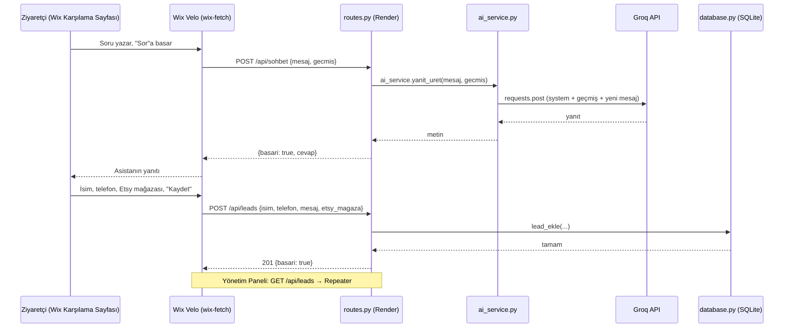

# SmartLead AI · AST Digital
## Ortam Kurulumu ve Mimari Tasarım Envanteri

**Hazırlayan:** Abdulsamed Tanrıverdi · **Marka:** AST Digital · **Güncelleme:** 11 Ekim 2026
**Eğitim:** Python ile Ürün Geliştirme · **Revize:** salih@humanports.com
**Dayanak:** SmartLead AI Öğrenci Proje Yönergesi (Bölüm 1–7)

---

## 1. Proje Özeti

SmartLead AI, AST Digital'in web sitesinde (Wix Studio) çalışan **akıllı satış asistanıdır**. AST Digital, Etsy'de satış yapan ya da yapmak isteyen üreticilere (tişört, kupa, tumbler gibi baskılı ve kişiye özel ürün satıcıları) dijital araçlar ve birebir danışmanlık sunar.

Asistanın görevleri:

1. Ziyaretçinin Etsy, listing, mockup ve paketlerle ilgili sorularını marka diliyle yanıtlamak.
2. Ziyaretçiyi ihtiyacına uygun pakete (Freemium / Premium) yönlendirmek.
3. Ziyaretçinin iletişim bilgisini (lead) toplayıp veritabanına kaydetmek; işletme sahibinin bu kayıtları yönetim panelinde görmesini sağlamak.

Sistem iki arayüzden oluşur: ziyaretçinin sohbet edip bilgi bıraktığı **Karşılama Sayfası (B2C)** ve işletme sahibinin lead'leri gördüğü **Yönetim Paneli (B2B)**.

Yönergeye göre **mimari (klasörler, katmanlar, kurallar) sabittir; değişen tek şey konudur.** AST Digital'e özel olan kısımlar yalnızca `BUSINESS_CONTEXT` metni, `leads` tablosundaki tek ek sütun ve arayüz metinleridir.

---

## 2. Ortam Kurulumu (Yönerge Bölüm 4 — Oturum Öncesi Hazırlık)

### 2.1 Hazırım Kontrol Listesi

| # | Madde | Durum |
|---|---|---|
| 1 | `py -3.11 --version` → Python 3.11.9 | ✅ |
| 2 | `git --version` → git 2.53.0 | ✅ |
| 3 | GitHub + Render + Wix + Groq hesapları açık | ✅ |
| 4 | Groq API anahtarı (`gsk_...`) alındı ve `.env` içine kaydedildi | ✅ |
| 5 | Klasör iskeleti hazır (Bölüm 3) | ✅ |
| 6 | `venv` aktif, `pip install -r requirements.txt` hatasız tamamlandı | ✅ |
| 7 | Duman testi tarayıcıda çalıştı | ✅ |

### 2.2 Kurulum Adımları (Windows · PowerShell)

```powershell
# Proje klasörü: ...\Desktop\SMARTLEAD.AI  (TNC-PROGRAM deposunun dışında, ayrı git deposu)
mkdir app, app\templates, app\services
New-Item run.py, config.py, requirements.txt, .env, .gitignore, `
  app\__init__.py, app\database.py, app\routes.py, `
  app\templates\index.html, app\templates\dashboard.html, `
  app\services\__init__.py, app\services\ai_service.py

py -3.11 -m venv venv
venv\Scripts\activate
pip install -r requirements.txt
```

**`requirements.txt`:** `flask` · `flask-cors` · `python-dotenv` · `requests` · `gunicorn`

> Bilgisayarda Python 3.14 de kurulu; bazı paketlerin henüz tam uyumlu olmaması ihtimaline karşı sanal ortam bilinçli olarak **Python 3.11** ile kuruldu.

### 2.3 Duman Testi

`hello.py` (proje dosyası değil, yalnızca ortam testi) çalıştırıldı; tarayıcıda "Ortam calisiyor!" yanıtı alındı. 5000 portu bilgisayarda başka bir uygulama tarafından kullanıldığı için test **5110** portunda yapıldı.


---

## 3. Hedef Mimari: Klasör Yapısı ve Sorumluluklar

```
SMARTLEAD.AI/
├── run.py                 ← Sunucuyu başlatan giriş noktası
├── config.py              ← Tüm ayarlar ve anahtarlar (.env okur)
├── requirements.txt       ← Bağımlılık listesi
├── .env                   ← Gizli anahtarlar (Git'e EKLENMEZ)
├── .env.example           ← .env'in anahtarsız örneği (Git'e eklenir)
├── .gitignore             ← venv/, .env, __pycache__/, *.db
├── README.md
├── docs/
│   ├── MIMARI.md          ← Bu belge
│   └── duman-testi.png
└── app/
    ├── __init__.py        ← Uygulama fabrikası: create_app() + /health
    ├── database.py        ← SQLite işlemleri (SQL SADECE burada)
    ├── routes.py          ← HTTP rotaları (sadece yönlendirme)
    ├── templates/
    │   ├── index.html     ← Karşılama sayfası (yerel test arayüzü)
    │   └── dashboard.html ← Yönetim paneli (yerel test arayüzü)
    └── services/
        ├── __init__.py
        └── ai_service.py  ← Yapay zekâ çağrıları (AI SADECE burada)
```

| Dosya | Tek sorumluluğu | Kesinlikle içermez |
|---|---|---|
| `config.py` | `.env`'den ayarları okuyup `Config` sınıflarında toplamak | SQL, AI çağrısı, rota |
| `app/database.py` | Bağlantı, tablo oluşturma, lead ekleme ve listeleme | AI çağrısı, HTTP |
| `app/services/ai_service.py` | Groq'a istek atıp asistanın yanıtını döndürmek | Flask, HTTP, SQL |
| `app/routes.py` | İsteği karşılamak, doğrulamak, ilgili katmanı çağırmak, JSON döndürmek | SQL metni, Groq isteği |
| `app/__init__.py` | Ayarları yüklemek, CORS'u açmak, veritabanını başlatmak, Blueprint'leri kaydetmek | İş mantığı |
| `run.py` | `create_app()` ile uygulamayı oluşturup çalıştırmak | Her şey dışında |

**Mimari sözleşme:** `database.py` dışında hiçbir yerde SQL yoktur. `ai_service.py` dışında hiçbir yerde yapay zekâ API çağrısı yoktur. `routes.py` yalnızca bu iki katmanın fonksiyonlarını çağırır.

---

## 4. Veri Akışı



---

## 5. Veri Modeli (Yönerge Modül B)

Tek tablo: **`leads`** — yönergedeki zorunlu şema + AST Digital'e özel **tek ek sütun**.

| Alan | Tür | Kural | Açıklama |
|---|---|---|---|
| `id` | INTEGER | PRIMARY KEY AUTOINCREMENT | Kayıt numarası |
| `isim` | TEXT | NOT NULL | Ad soyad |
| `telefon` | TEXT | NOT NULL | WhatsApp numarası |
| `mesaj` | TEXT | opsiyonel | Ziyaretçinin notu |
| `etsy_magaza` | TEXT | opsiyonel — **AST Digital'e özel ek sütun** | Etsy mağaza bağlantısı (başvuru değerlendirmesi için) |
| `tarih` | TIMESTAMP | `DEFAULT CURRENT_TIMESTAMP` | Kayıt zamanı |

Yönergenin izin verdiği kişiselleştirme ("restoran için `kisi_sayisi`, emlak için `butce`") AST Digital'de `etsy_magaza` olarak uygulanır; fonksiyonlar ve form bu sütuna göre güncellenir.

**16 Ekim eklemeleri** (canlı testte görülen ihtiyaçlardan):

| Tablo · Alan | Neden |
|---|---|
| `leads.mesaj` | Artık ziyaretçinin tüm sohbeti (`Ziyaretçi: … / Asistan: …` satırları, son 12.000 karakter) |
| `leads.eposta` | Giriş ekranında ad + e-posta alınır; telefon zorunlu değil (telefonsuz kayıtta `''`) |
| `leads.kvkk_onay` | KVKK onayının verildiği zaman (kanıt) |
| **`sohbetler`** tablosu: `oturum` (PK), `dokum`, `mesaj_sayisi`, `lead_id`, `z_isim`, `z_eposta`, `ilk_tarih`, `son_tarih` | Form doldurulmasa da her sohbet kaydedilir (analiz için). `oturum` = tarayıcıda üretilen rastgele kimlik; lead'e dönüşürse `lead_id` ile bağlanır |

Eski veritabanı dosyaları açılışta otomatik güncellenir (`PRAGMA table_info` + `ALTER TABLE ADD COLUMN`).

---

## 6. Modüllerin Fonksiyonları (Yönerge Modül A–E)

Kod öğrenci tarafından yazılacaktır; aşağıdakiler her modülün **ne içermesi gerektiğinin** tanımıdır.

### Modül A — `config.py`
- Dosyanın başında `load_dotenv()`.
- `Config` sınıfı: `SECRET_KEY`, `DATABASE_URL` (varsayılan `smartlead.db`), `GROQ_API_KEY`, `AI_PROVIDER` (`groq`), `BUSINESS_CONTEXT`, `CORS_ORIGINS`.
- Her ayar `os.environ.get('ANAHTAR', 'varsayilan')` deseniyle okunur.
- `DevelopmentConfig` (`DEBUG = True`) ve `ProductionConfig` (`DEBUG = False`) + bunları seçen sözlük (`config = {'development': ..., 'production': ...}`).
- **Kontrol noktası:** `config.py` import edilip bir ayar yazdırılabiliyor ve `.env`'deki değer geliyor.
- ✅ 11 Ekim: tamamlandı ve test edildi. Not: `BUSINESS_CONTEXT` (chatbot'un sistem talimatı) ilk sürümdür; paket ayrıntıları ve SSS eklenerek geliştirilecek.

### Modül B — `app/database.py`

| Fonksiyon | Görevi |
|---|---|
| `get_db()` | Veritabanına bağlanır; `row_factory` ile satırlara sütun adıyla erişim sağlar |
| `init_db(app)` | `leads` tablosunu oluşturur (yoksa) |
| `lead_ekle(isim, telefon, mesaj, etsy_magaza=None)` | `?` yer tutucularıyla yeni kayıt ekler |
| `tum_leadler()` | Tüm kayıtları en yeniden eskiye getirir |

- ✅ 11 Ekim: tamamlandı. `test_modul_b.py` ile ayrı bir `test.db` üzerinde kayıt ekleme ve listeleme test edildi. SQL enjeksiyonu denemesi (`Robert'); DROP TABLE leads;--`) tablo silinmeden düz metin olarak kaydedildi; `?` yer tutucusu çalışıyor.

### Modül C — `app/services/ai_service.py`
- `AIService` sınıfı ve `yanit_uret(mesaj, gecmis)` metodu.
- `BUSINESS_CONTEXT`'i config'den okuyan yardımcı metot.
- Groq'a **`requests.post`** ile istek atan metot — model: **`openai/gpt-oss-20b`** (`GROQ_MODEL` ortam değişkeninden okunur).
- **Yönergeden bilinçli sapma:** Yönergedeki `llama-3.1-8b-instant` modeli Groq tarafından 16 Ağustos 2026'da kapatıldı (API 404 döndürüyor). Groq'un önerdiği yerine geçen model `openai/gpt-oss-20b` kullanıldı. Model adı koda gömülmek yerine config'e taşındı; ileride bir model daha kapanırsa yalnızca ortam değişkeni değişir. Kaynak: https://console.groq.com/docs/deprecations
- `messages` sırası: önce sistem talimatı (`role: system`), sonra geçmiş mesajlar, en sonda yeni kullanıcı mesajı.
- Anahtar yoksa çökmek yerine **"demo modu"** mesajı döndürür.
- Servise özel hata sınıfı `AIServiceError`; istek `try-except` ile sarılır, hata olursa `AIServiceError` fırlatılır.
- Dosya sonunda tek örnek: `ai_service = AIService()`.
- Bu dosya Flask, HTTP veya veritabanı kavramlarını bilmez; sağlayıcı değişikliği (Groq → Gemini) yalnızca burayı etkiler.
- ✅ 11 Ekim: tamamlandı. `test_modul_c.py` ile 4 test: gerçek soru, konuşma geçmişini hatırlama, anahtarsız demo modu, yanlış anahtarda `AIServiceError` (401) yakalama.
- **Test sırasında bulunan sorun ve çözümü:** İlk sürümde model olmayan bir üyelik linki uydurdu, pakette olmayan hizmetler (stok yönetimi, otomatik fiyat güncelleme) vaat etti ve Markdown kullandı. Çözüm: `BUSINESS_CONTEXT`'e gerçek paket içerikleri, izin verilen tek link/e-posta ve kurallar (uydurma yok, satış garantisi yok, düz metin, kısa cevap) eklendi; ayrıca cevaplar `_temizle()` ile Markdown yıldızlarından arındırılıyor (talimata güvenmek yerine kodda garanti).

### Modül D — `app/routes.py`
- İki Blueprint: **sayfalar** (`/`, `/dashboard`) ve **API** (`url_prefix='/api'`).
- Her API uç noktası `basari` alanı içeren JSON döndürür.
- Durum kodları: eksik veri **400**, AI hatası **503**, yeni kayıt **201**.
- `AIServiceError` yakalanıp kibar JSON hata döndürülür.
- ✅ 11 Ekim: tamamlandı. Ek olarak:
  - **Girdi doğrulama (sunucuda):** isim yalnızca harf/boşluk/`.'-` (2–100), telefon yalnızca rakam/boşluk/`+()-` (10–13 hane, tek biçimde saklanır), Etsy mağaza adı 4–20 harf/rakam. Tarayıcı izinsiz karakteri hiç yazdırmaz; asıl kontrol sunucudadır.
  - **`ADMIN_KEY`:** `GET /api/leads` müşteri telefonlarını döndürdüğü için canlıda yalnızca `X-Admin-Key` başlığıyla erişilebilir (401); KVKK metniyle tutarlı.
  - Yerel arayüz (`index.html`): marka avatarı, "yazıyor…" animasyonu (en az 2–4 sn), katlanır "Size dönüş yapalım" formu; tüm metinler `textContent` ile basılır (XSS'e karşı).

### Modül E — `app/__init__.py` + `run.py`
- `create_app()` sırası: ayarları yükle → CORS aç → `with app.app_context(): init_db(app)` → Blueprint'leri kaydet → uygulamayı döndür.
- `/health` uç noktası (canlılık kontrolü).
- `run.py`: `app = create_app()` · `if __name__ == '__main__': app.run(port=5110, debug=True)` · Render'da `gunicorn run:app`.
- ✅ 11 Ekim: tamamlandı. Ortam `APP_ENV` ile seçilir (yerelde development, Render'da production). CORS yalnızca `/api/*` için ve yalnızca `CORS_ORIGINS` listesindeki alan adlarına açık; başka site engellenir (test edildi).

---

## Modül F — Testler

- **16 Ekim güncel: 56 test.** Yeni testler: sohbet kaydı ve oturum, sohbete yazılan telefonla otomatik lead, e-posta ile telefonsuz lead, aynı oturumda tek lead, ziyaretçinin sohbetini silmesi, KVKK onayı (onaysız lead 400, onaysız sohbetteki telefon kaydedilmez), sahte form satırı temizliği, önbellek başlığı.
- `python -m pytest -v` → **30 test** (11 Ekim), Groq'a bağlanmadan ve gerçek veritabanına dokunmadan (her test geçici `test.db` kullanır) ~1 saniyede çalışır.
- `tests/test_api.py` (16): `/health`, sayfalar, `/api/sohbet` (400 / 200 demo / 503), `/api/leads` (201, telefon standardı, geçersiz isim/telefon/mağaza → 400, SQL enjeksiyonu, sıralama), `ADMIN_KEY` (401/200), CORS (Wix izinli, başka site engelli).
- `tests/test_ai_service.py` (6): demo modu, mesaj sırası ve 10 mesaj sınırı, sahte `system` mesajının sızmaması, Markdown temizliği, ikinci örneği durduran kod kapısı.
- **Testin yakaladığı hata:** Markdown temizliği Groq isteği fonksiyonunun içindeydi; tüm cevapların geçtiği `yanit_uret()`'e taşındı.
- Elle çalıştırılan denemeler (gerçek Groq'a gider): `test_modul_b.py`, `test_modul_c.py`, `test_sinirlar.py` — `pytest.ini` bunları otomatik takıma almaz.

---

## Modül H — Canlı yayın (Render)

- Adres: **https://smartlead-ai-dse5.onrender.com** · `/health` → `{"durum":"aktif"}` ✅ (11 Ekim)
- Ayarlar: Frankfurt bölgesi, Free plan, Build `pip install -r requirements.txt`, Start `gunicorn run:app`.
- Ortam değişkenleri (değerleri yalnızca Render panelinde): `APP_ENV=production`, `GROQ_API_KEY`, `SECRET_KEY`, `ADMIN_KEY`, `PYTHON_VERSION=3.11.9`.
- **Canlı saldırı testi (11 Ekim):** sistem talimatı sızdırma, DAN rol yapma, hakaret, sahte fiyat onayı, rakip kötüleme, satış garantisi, İngilizce "ignore instructions", müşteri verisi isteme, sahte marka, kod yazdırma → **10/10 dayandı.** API: anahtarsız/yanlış anahtarla lead listesi 401, XSS denemesi 400, bozuk JSON 400, hata ayrıntısı sızmıyor.
- **Canlı testte bulunan kritik sorun:** art arda 3 mesajda Groq 429 (istek sınırı) → bot ~1 dk sustu ve kullanıcıya "kod 429" gösterdi. Çözüm: 429'da kısa bekleyip bir kez yeniden deneme + anlaşılır mesaj (2 yeni test).
- **Ücretsiz plan kısıtları:** 15 dk trafik yoksa uyur, ilk istek ~1 dk sürer. Dosya sistemi kalıcı değil → **SQLite'taki lead'ler uyku/yeniden yüklemede silinir.**

---

## ⚠️ MUTLAKA DÖNÜLECEK — Chatbot ince ayarı (Belgrad öncesi)

> Bu bölüm bitmeden sunuma çıkılmaz. Her maddeyi çözünce `test_sinirlar.py`'ye test olarak ekle ve işaretle.

**Bugüne kadar bulunan ve çözülenler (11 Ekim):** uydurma link · pakette olmayan hizmet vaadi · Markdown · imza · konu dışına çıkma · "hatırlıyorum" yalanı · fazla katı kalıp red · gri alanı (+18 ürün) reddetme · marka/telif riski (FIFA, World Cup, "Official") · 30+ etiket · ikinci örneği bedava verme (kod kapısıyla).

**Açık kalanlar:**
- [ ] İlk tadımlık örnekte etiket sayısı (en fazla 5) ve açıklama yazmama kuralı da kodla garanti altına alınmalı (şu an yalnızca talimat).
- [x] Ret mesajları her seferinde farklı cümleyle kurulacak (16 Ekim, talimata eklendi).
- [ ] Etiket kalitesi: bitişik yazım, ürünle ilgisiz kelimeler (ör. "military shirt") — gözlemlenecek.
- [x] Sohbette isim/telefon yazan kullanıcı (16 Ekim): KVKK onayı verdiyse telefon koddan yakalanıp lead'e eklenir, bot "kayıt yapamıyorum" yerine teşekkür eder. Bot sohbete sahte form ("Adınız: / Telefon:") yazarsa kod bu satırları siler.
- [x] Bot verilen bilgiyi tekrar soruyordu (16 Ekim): geçmiş artık rol bazlı kırpılıyor (kullanıcı 500, bot 220 karakter, son 12 mesaj); "verilen bilgiyi tekrar sorma", en fazla 3–4 cümle kuralı.
- [x] Hitap "siz" olarak sabitlendi (16 Ekim).
- [ ] `gpt-oss-120b` ile karşılaştırma testi: kurala uyum / hız / kota.
- [x] **Groq istek sınırı (16 Ekim):** Ücretsiz plan dakikada 8.000 / günde 200.000 token. Sistem talimatı 6.440 → 2.738 karaktere indirildi (kurallar korunarak), geçmiş son 8 mesaj ve mesaj başına 600 karakterle sınırlandı, cevap 600 token. IP başına sınır: sohbet dakikada 6, lead 10 dakikada 3 istek (aşılırsa 429 + Türkçe mesaj). 8 yeni test → toplam 30 test.
- [x] **Lead'lerin kalıcılığı — karar (16 Ekim):** Yönergeye ve ders notlarına sadık kalınarak SQLite korunuyor (ders notlarında CMS'e yazma istenmiyor). Render Free'de dosya sistemi kalıcı olmadığı için sunucu uyuyunca kayıtlar sıfırlanır; bu bilinen bir kısıttır. Jüri planı: sunumdan önce sunucu uyandırılır, canlı demoda lead girilip panelde gösterilir. Üretim için çözüm: kalıcı disk veya harici veritabanı (Postgres) — `database.py` tek dosya olduğu için geçiş yalnızca bu katmanı etkiler.
- [ ] **Soğuk başlangıç:** sunumdan 2 dk önce `/health` açılıp sunucu uyandırılacak (ya da 10 dk'da bir ping atan izleme servisi).
- [x] 404 / 405 / 500 artık Türkçe JSON döner (16 Ekim).

---

## 7. API Uç Noktaları (Yönerge Modül D)

| Metot + Yol | Görevi | Çağırdığı katman | Girdi | Başarılı çıktı |
|---|---|---|---|---|
| GET `/` | Karşılama sayfası | `render_template` | — | `index.html` |
| GET `/dashboard` | Yönetim paneli | `render_template` | — | `dashboard.html` |
| POST `/api/sohbet` | AI'a mesaj iletir | `ai_service.yanit_uret()` | `{"mesaj": str, "gecmis": [...]}` | `{"basari": true, "cevap": str}` |
| POST `/api/leads` | Yeni lead kaydeder | `database.lead_ekle()` | `{"isim", "telefon", "mesaj", "etsy_magaza"}` | 201 `{"basari": true}` |
| GET `/api/leads` | Tüm lead'leri getirir | `database.tum_leadler()` | — | `{"basari": true, "leadler": [...]}` |
| GET `/health` | Canlılık kontrolü | — | — | `{"durum": "aktif"}` |
| GET `/widget` | Wix popup'ına gömülen sohbet penceresi | `render_template` | — | `index.html` (tam ekran) |
| GET `/kvkk` | KVKK Aydınlatma Metni | `render_template` | — | `kvkk.html` |
| GET `/api/sohbetler` | Tüm sohbetler (yönetici) | `database.tum_sohbetler()` | `X-Admin-Key` | `{"basari": true, "sohbetler": [...]}` |
| DELETE `/api/sohbet/<oturum>` | Ziyaretçi kendi sohbetini siler | `database.sohbeti_sil()` | — | `{"basari": true}` |

`POST /api/sohbet` ek alanları: `oturum`, `isim`, `eposta`, `kvkk_onay` → cevapta `kaydedildi` (sohbete yazılan telefon lead olduysa `true`).
`POST /api/leads` ek alanları: `eposta`, `oturum`, **`kvkk_onay: true` zorunlu** (yoksa 400). Telefon veya e-posta'dan biri yeterli.
HTML ve JSON cevapları `Cache-Control: no-store` ile döner (push sonrası eski sürüm görünmesin).

**Hata formatı (tüm API uç noktalarında aynı):**

```json
{ "basari": false, "hata": "Kullanıcıya gösterilebilecek kısa açıklama" }
```

**Alan adları sözleşmesi (Yönerge Modül G — "Aynı Kelimeler"):** sohbet için `mesaj` / `cevap` / `oturum`, kayıt için `isim` / `telefon` / `eposta` / `mesaj` / `etsy_magaza` / `kvkk_onay`, liste için `leadler` ve `sohbetler`. Wix tarafı bu adları birebir kullanır.

---

## 8. Asistanın Kişiliği: `BUSINESS_CONTEXT`

Kodun konuya özel tek parçası budur.

```python
BUSINESS_CONTEXT = """Sen AST Digital'in asistanisin. AST Digital, Etsy'de satis yapan
ya da yapmak isteyen ureticilere (tisort, kupa, tumbler gibi baskili ve kisiye ozel
urun saticilari) dijital araclar ve birebir danismanlik sunar.

Paketler:
- Freemium (ucretsiz): gunde 5 listing + mockup, ticket ile destek, haftalik tanitim yayini.
- Premium (aylik 39 $, 7 gun ucretsiz deneme): gunde 20 listing + mockup,
  gunde 5 otomatik Pinterest pini, mesai saatlerinde WhatsApp'tan birebir danismanlik,
  haftalik soru-cevap yayini.
Uyelik basvuruyla acilir: kisa form doldurulur, Etsy magazasi incelenir, onaylanan
saticiya hesap acilir. Premium basvurularinda 20 dakikalik tanisma gorusmesi yapilir.

Kurallar:
- Turkce, samimi, net ve cesaret veren bir dille konus. Kisa yanit ver (en fazla 4-5 cumle).
- Kesin satis vaat etme; yolu kisaltmayi vaat et.
- Bilmedigin bir konuda uydurma; "Bunu ekibimiz netlestirsin" de ve iletisim bilgisi iste.
- Konusma ilerledikce uygun paketi oner ve isim, telefon ve Etsy magaza
  baglantisini birakmasini nazikce iste.
- Etsy, e-ticaret ve AST Digital disindaki konulara girme."""
```

---

## 9. Güvenlik (Değerlendirme %10)

| Konu | Uygulama |
|---|---|
| SQL enjeksiyonu | Tüm sorgularda `?` yer tutucusu; kullanıcı verisi asla SQL metnine eklenmez. |
| Gizli anahtarlar | `GROQ_API_KEY`, `SECRET_KEY` yalnızca `.env`'de (yerel) ve Render "Environment" ayarlarında. `.env` `.gitignore`'da; depoda yalnızca `.env.example` bulunur. |
| CORS | `CORS_ORIGINS` ile yalnızca `https://astdigital.wixstudio.com` ve Wix editör/önizleme alan adlarına izin verilir; `*` kullanılmaz. |
| Girdi doğrulama | Boş mesaj, aşırı uzun mesaj (ör. 1000 karakter üstü), isim veya telefonu eksik lead → 400. |
| KVKK | Karşılama sayfasındaki formda KVKK aydınlatma metnine bağlantı ve onay kutusu bulunur (site KVKK politikasıyla uyumlu). |
| Lead listesi (ek, Belgrad aşaması) | `GET /api/leads` herkese açık kalmamalı; Wix tarafında Velo backend + Secrets Manager'da tutulan bir anahtarla çağrılması planlanır. |

---

## 10. Hata Yönetimi (Değerlendirme %10)

- Veritabanı ve Groq çağrıları `try-except` ile sarılır.
- Kullanıcıya teknik ayrıntı gösterilmez; yalnızca `{"basari": false, "hata": "..."}` döner.
- Hatanın ayrıntısı sunucu loguna yazılır (Render "Logs" ekranından izlenir).
- Groq anahtarı yoksa asistan **demo modu** yanıtı verir; Groq'a ulaşılamazsa 503 ile kibar bir mesaj döner: *"Şu an yanıt veremiyorum, bilgilerini bırakırsan ekibimiz WhatsApp'tan dönsün."*

---

## 11. Wix Bağlantısı (Yönerge Modül G)

| Arayüz | Uygulama | Backend |
|---|---|---|
| **Karşılama (B2C) — tüm sayfalarda asistan** | Sabit üst bantta `#btnAsistan` → Wix **Popup** → içine Render'daki `/widget` gömülü (Embed a Site, 380×560) | Widget doğrudan `POST /api/sohbet`, `POST /api/leads`, `DELETE /api/sohbet/<oturum>` |
| **Yönetim Paneli (B2B)** | Gizli "Yönetim" sayfası · **F-Pattern** · KPI kartları + arama + sekmeler + `#repeaterLeads` (her öğe `_id`, `$item`) | Velo backend web modülü (`wix/backend/smartlead.web.js`) → `wix-fetch` → `GET /api/leads`, `GET /api/sohbetler` |

**Yönergeden bilinçli sapma (sohbet):** Sohbet Wix Input'larıyla değil gömülü pencereyle yapıldı. Sebepleri:
1. **Tüm sayfalarda çalışır:** Wix'te global sabit öğe yok; popup her sayfadan aynı pencereyi açar.
2. **IP sınırı çalışır:** İstek ziyaretçinin tarayıcısından gelir. `wix-fetch` backend'den gitseydi tüm ziyaretçiler Wix'in IP'sinden geliyormuş gibi görünür, istek sınırı anlamsızlaşırdı.
3. **Daha zengin deneyim:** "yazıyor…" animasyonu, giriş ekranı, kalıcı sohbet geçmişi ("Sohbetlerim"), sohbet silme — Wix bileşenleriyle kodla oluşturulamaz.

**Yönetim Paneli Wix'te ve Velo ile:** Anahtar (`ADMIN_KEY`) **Wix Secrets Manager**'da (`SMARTLEAD_ADMIN_KEY`) durur, tarayıcıya hiç inmez. Web modülü `Permissions.Admin` ile korunur: yalnızca site yöneticisi veri alabilir. Render uykudaysa sayfa sunucuyu uyandırıp 15 sn arayla 4 kez dener. Sohbet metni `$item('#txtSohbet').html` ile basılır; kullanıcı metni önce HTML'den kaçırılır (XSS). Yedek panel: `https://smartlead-ai-dse5.onrender.com/dashboard`.

**Ziyaretçi akışı:** Giriş ekranı (ad soyad + e-posta + **KVKK onay kutusu**, isteğe bağlı "Bilgi vermeden devam et") → sohbet → sohbet tarayıcıda saklanır, site kapansa da devam eder → "Sohbetlerim"den eski sohbetler açılır veya silinir (sunucudan da silinir; bırakılan iletişim bilgisi kalır).

---

## 12. Yayınlama (Yönerge Modül H)

1. **GitHub:** ayrı, public depo — **github.com/Allahverdyy/smartlead-ai**. `.env` ve `venv/` yüklenmez. ✅
2. **Render → New Web Service:** depo bağlanır.
   - Build: `pip install -r requirements.txt`
   - Start: `gunicorn run:app`
   - Environment: `GROQ_API_KEY`, `SECRET_KEY`, `CORS_ORIGINS`
3. `https://<servis>.onrender.com/health` → `{"durum": "aktif"}` dönünce Wix kodundaki API adresi Render adresiyle güncellenir.

**Bilinen kısıt:** Render'ın ücretsiz planında disk kalıcı değildir; yeniden yayında SQLite dosyası sıfırlanabilir ve servis 15 dakika boşta kalınca uykuya geçer. MVP ve jüri sunumu için kabul edilebilir; kalıcı kullanımda PostgreSQL'e geçilir. Mimari buna hazırdır: yalnızca `database.py` değişir.

---

## 13. Durum ve Zaman Çizelgesi (Yönerge Bölüm 6)

| Aşama | Modül | Durum |
|---|---|---|
| Ortam + hesaplar + iskelet + duman testi | Bölüm 4 | ✅ 7 Ekim |
| Mimari tasarım (bu belge) | — | ✅ 11 Ekim |
| GitHub deposu + iskelet commit | Modül H (1–2) | ✅ 7 Ekim |
| Yapılandırma | Modül A | ✅ 11 Ekim |
| Veritabanı | Modül B | ✅ 11 Ekim |
| Yapay zekâ servisi | Modül C | ✅ 11 Ekim |
| Rotalar · Fabrika + giriş | Modül D–E | ✅ 11 Ekim |
| Çalıştırma + test | Modül F | ✅ 16 Ekim — `pytest`: 56 otomatik test |
| Chatbot ince ayarı | — | ⚠️ Açık maddeler var (yukarıda) |
| Wix Karşılama (asistan popup, tüm sayfalar) | Modül G | ✅ 16 Ekim |
| Wix Yönetim Paneli (Velo + Repeater) | Modül G | 🟡 16 Ekim — kod hazır (`wix/`), Wix'e kurulum |
| KVKK onayı + Aydınlatma Metni (`/kvkk`) | Modül G | ✅ 16 Ekim |
| Render'da canlı yayın | Modül H (3–5) | ✅ 11 Ekim — https://smartlead-ai-dse5.onrender.com |
| README son hali, sunum/demo | Teslim | ⬜ 27 Ekim jüri |

---

*Bu belgenin yapısı ve taslak metni hazırlanırken yapay zekâ desteği (Claude) kullanılmıştır; mimari kararlar öğrenci tarafından sahiplenilmiş, kod öğrenci tarafından yazılacak ve sözlü olarak açıklanabilecek şekilde gözden geçirilecektir.*
